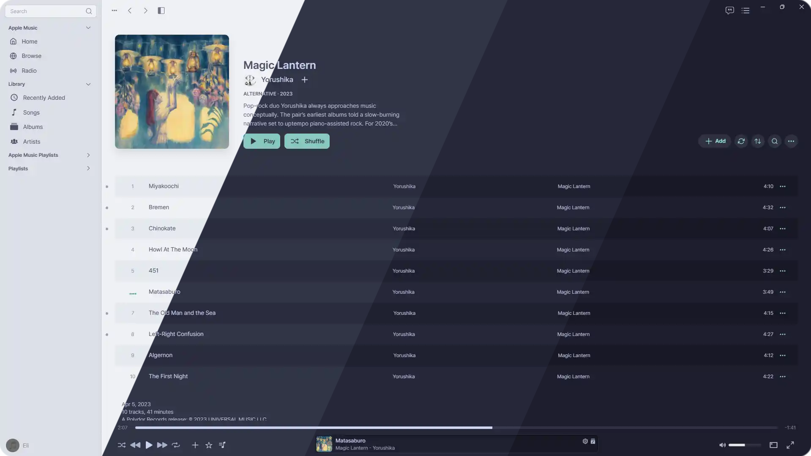
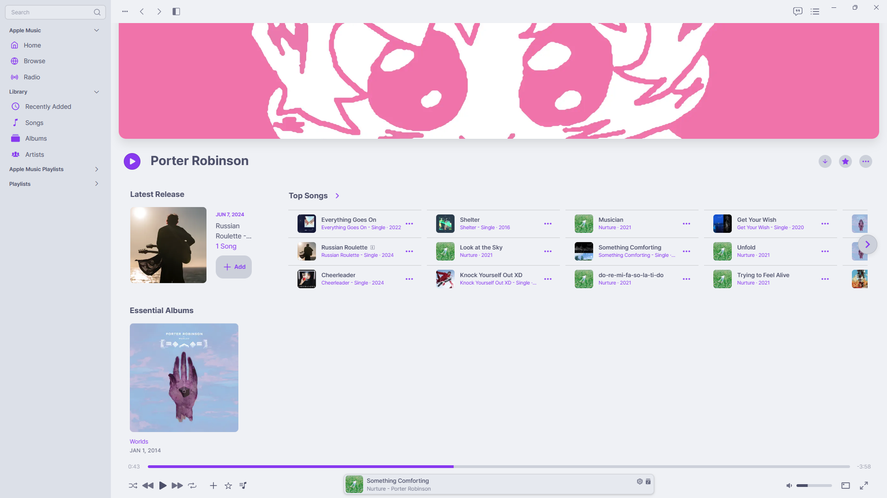
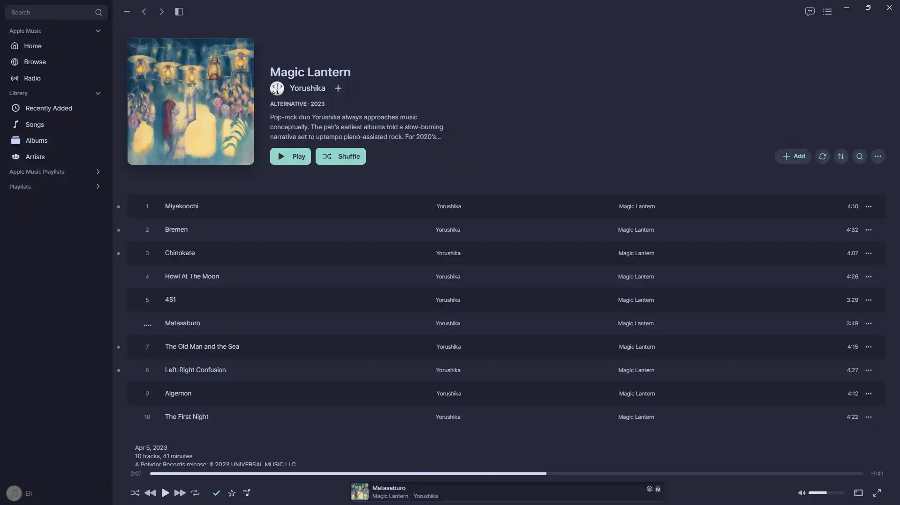
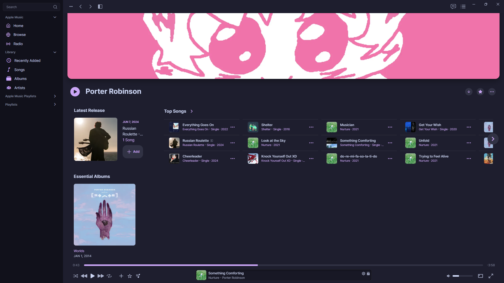

<h3 align="center">
	 
	
	Catppuccin for <a href="https://github.com/ciderapp">Cider</a>
	
</h3>

	
	
	

	

## Previews

🌻 Latte

🪴 Frappé

🌺 Macchiato

🌿 Mocha

## Usage

1. Open Cider
2. Menu → Marketplace → Themes
3. Find Catppuccin and your favorite flavor
4. Click `Install`
5. Menu → Settings → Extensions → Themes
6. Enable the base theme
7. (Optional) Enable an accent color alongside the base theme — see [note on accent colors](#main-menu-accent-color)

## Notes

### Immersive / Coverflow Mode

Immersive and Coverflow modes uses **dark-mode** theming in-app. If you're using a Latte theme, it is recommended that you also **enable** a dark-mode theme (Frappé / Macchiato / Mocha) to have theming inside the Immersive and Coverflow modes.

### Main Menu Accent Color

The main menu can no longer be fully themed — only the highlight/accent color can be matched to your flavor. To do so, enable a custom accent color in Cider (**Menu** > **Settings** > **Visual** > **Custom Accent Color**) and set it to the hex value of `--accent` from your installed accent theme file (e.g. `catppuccin-accent-mauve.scss`, which contains `#cba6f7` for Mocha Mauve).

## 💝 Thanks to

- [winston](https://github.com/nekowinston)
- [Eli](https://github.com/Flapperoo)

&nbsp;

	

	Copyright &copy; 2021-present <a href="https://github.com/catppuccin" target="_blank">Catppuccin Org</a>

	

